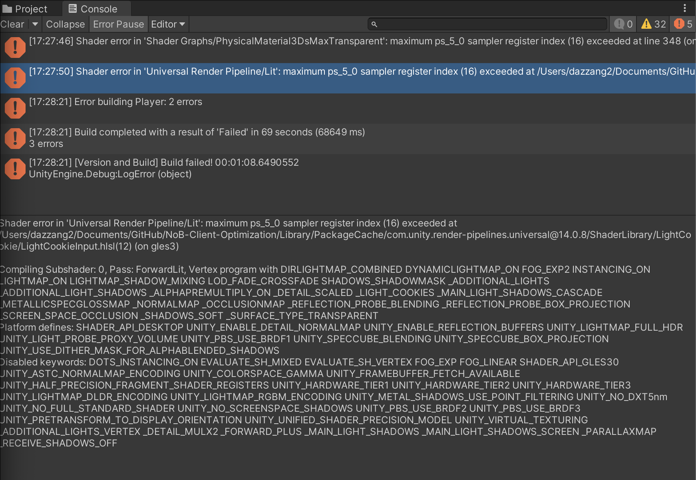
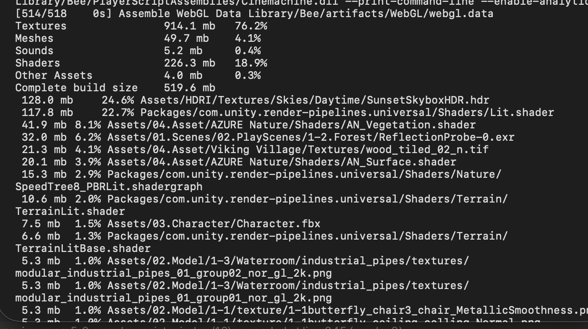
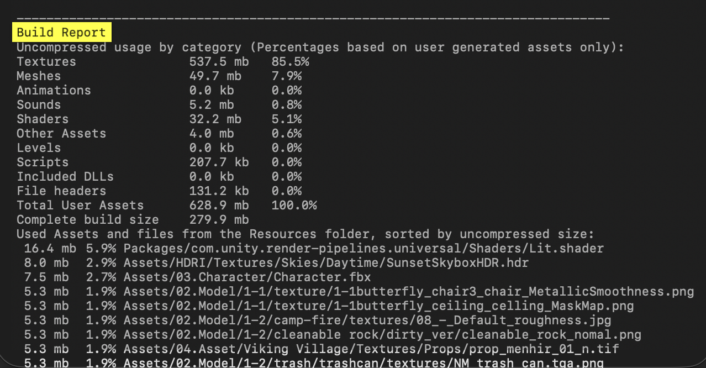
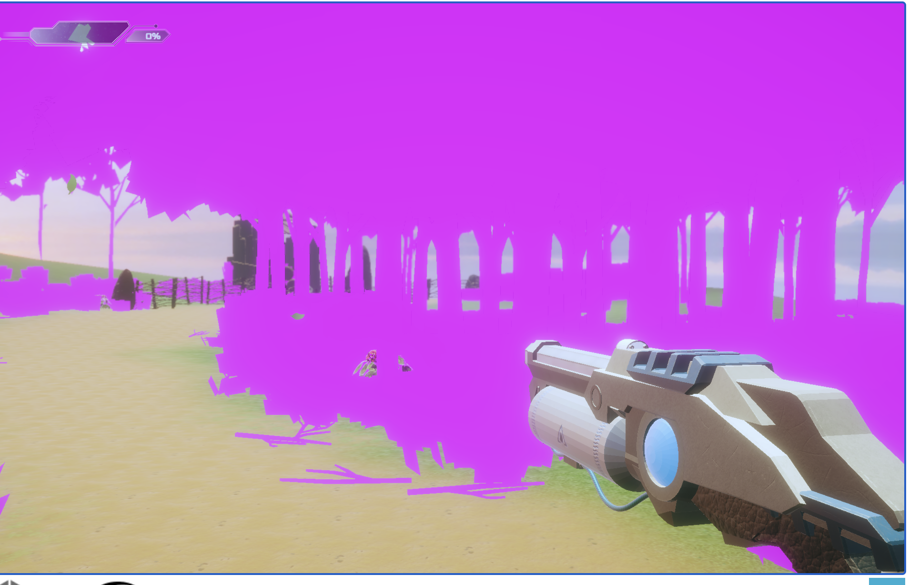
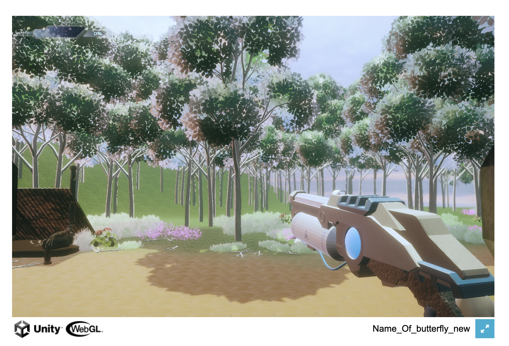

# Name of Butterfly

> 주변 오브젝트를 조사하고 단서를 연결해 진행하는 1인칭 3D 어드벤처 게임


플레이어는 Drawing, ID Card, Password Device와 상호작용하며 우주선·숲·연구소를 탐색합니다. 이 저장소는 팀 프로젝트의 **개인 개선 fork**입니다. 아래에서는 원 프로젝트에서 맡은 상호작용 구현과 2026년의 Target Selection·WebGL 후속 작업을 시점별로 구분합니다.

| 항목 | 내용 |
|---|---|
| 플랫폼 | Windows · macOS · WebGL 포팅 |
| 엔진 | Unity 2022.3.10f1 · C# · URP |
| 팀 | 6명 중 클라이언트 2명 |
| 원 프로젝트 | 2023.09–2024.01 |
| 개인 후속 개선 | 2026년 |

## 제가 맡은 범위

| 시점 | 작업과 책임 |
|---|---|
| 원 프로젝트 | Drawing 조사 상태 전환, 카메라 이동과 입력 차단·복구, ID Card→Password 상호작용 시퀀스 및 피드백 |
| 2026 · 직접 구현 | 사용자 시선에 맞는 선택 정책과 후보 탐색 책임 통합, 실제 플레이 확인 |
| 2026 · Codex 보조 | Target Selection 테스트 케이스 작성 보조. 정책과 통합 구현을 AI 성과로 표기하지 않음 |
| 2026 · AI 협업 | WebGL Shader/Build Report·Terrain 참조 분석, 반복 변환용 Unity Editor Tool 코드는 Codex가 작성. 저는 요청 범위와 수정 단위를 정하고 도구를 실행해 Unity·WebGL 결과를 검증 |

## 1. 상호작용 상태와 입력 복구

Drawing은 E 키 한 번으로 끝나는 오브젝트가 아닙니다. [`DrawingPicker`](Assets/05.Scripts/1-1.Spacecraft/DrawingPicker.cs)는 **조사 진입 → 뒷면 확인 → 원위치 복귀**를 상태로 나눕니다. 선택된 오브젝트만 입력을 받으며, 조사 중 잠근 플레이어 입력은 종료 때 복구합니다.

```csharp
GameObject closestObject = OutlineSelection.ClosestObject;
if (closestObject == null || closestObject!= gameObject || !gameObject.CompareTag("SelectableDrawing")) return;
```

```csharp
switch (currentState)
{
    case ObjectState.None:
        EnterInspectMode(currentObject);
        currentState = ObjectState.FacingFront;
        break;
    case ObjectState.FacingFront:
        RotateObject(currentObject);
        currentState = ObjectState.FacingBack;
        break;
    case ObjectState.FacingBack:
        ExitInspectMode(currentObject);
        currentState = ObjectState.None;
        currentObject = null;
        break;
}
```

종료 경로의 `ExitInspectMode()`는 `ResetObjectPosition(obj)` 후 `playerController.enabled = true`로 입력을 돌려놓습니다. 상태 전환과 복구가 서로 맞물리는 부분이 제 원래 상호작용 코드의 핵심입니다.

ID Card와 Password 이벤트는 Coroutine으로 입력 잠금, 카메라 이동, 카드 삽입, Password 화면 진입과 복귀의 순서를 관리합니다. Coroutine은 이 시퀀스의 실행 순서를 위한 선택이지, 성능 향상 수단이라는 주장이 아닙니다. [`PasswordEventCameraController`](Assets/05.Scripts/1-1.Spacecraft/PasswordEventCameraController.cs) · [상호작용 흐름 문서](docs/interaction-orchestration.md)

## 2. 거리 우선 선택에서 시선 우선 선택으로

**문제.** 실제 플레이에서 화면 중앙의 A를 바라보는데 물리적으로 가까운 B가 선택되어 상호작용이 빗나가는 상황을 반복 재현했습니다. 사용자가 보는 방향과 선택 결과를 맞추기 위해 선택 순서를 바꿨습니다.

**Before — 가장 가까운 후보를 우선.** [개선 전 `OutlineSelection`](https://github.com/dazzang22/NoB-Client-Optimization/blob/806a45c623a2f2ed67d1c4eba075a16861223ff9/Assets/05.Scripts/1-1.Spacecraft/OutlineSelection.cs)은 활성 후보를 순회하며 거리 제곱을 비교했습니다.

```csharp
float sqrDistance = (info.transform.position - cameraPosition).sqrMagnitude;
if (sqrDistance <= maxSqrDistance &&
    sqrDistance < closestSqrDistance)
{
    closest = info;
    closestSqrDistance = sqrDistance;
}
```

기존에는 중앙의 선택 로직과 오브젝트별 `DrawingPicker`가 후보 탐색을 중복 수행할 수 있었습니다. [`DrawingPicker` 이전 코드](https://github.com/dazzang22/NoB-Client-Optimization/blob/806a45c623a2f2ed67d1c4eba075a16861223ff9/Assets/05.Scripts/1-1.Spacecraft/DrawingPicker.cs)는 시작 시 자신의 오브젝트에 `OutlineSelection`이 없으면 런타임에 추가했습니다.

```csharp
outlineSelection = GetComponent<OutlineSelection>();
if (outlineSelection == null)
{
    outlineSelection = gameObject.AddComponent<OutlineSelection>();
}
```

**After — 중앙에서 한 번 선택하고 결과를 공유.** 현재 [`OutlineSelection`](Assets/05.Scripts/1-1.Spacecraft/OutlineSelection.cs)은 `Awake()`에서 태그별 후보·`Outline`·`Transform`을 캐시합니다. 탐색 시 비활성·거리 초과·Viewport 밖·카메라 뒤 후보를 제외한 뒤, 시선과 후보 방향의 내적을 계산합니다.

```csharp
Vector3 directionToObject = candidate.transform.position - cameraPosition;
float sqrDistance = directionToObject.sqrMagnitude;
// 거리와 화면 범위 필터 생략
Vector3 viewportPoint = mainCamera.WorldToViewportPoint(candidate.transform.position);
// Viewport 및 카메라 뒤쪽 필터 생략
Vector3 directionToObjectNormalized = directionToObject.normalized;
float alignment = Vector3.Dot(cameraForward, directionToObjectNormalized);
```

[`TargetSelectionPolicy.IsBetterCandidate()`](Assets/05.Scripts/1-1.Spacecraft/TargetSelectionPolicy.cs)은 **시선 정렬 점수를 먼저 비교**하고, 차이가 `0.02` 이하일 때만 거리를 비교합니다.

```csharp
if (alignment > bestAlignment + AlignmentTieThreshold)
    return true;

bool hasSimilarAlignment =
    Mathf.Abs(alignment - bestAlignment) <= AlignmentTieThreshold;
return hasSimilarAlignment && sqrDistance < bestSqrDistance;
```

`0.02`는 초기 기준으로 두었고 별도의 정량 튜닝 결과라고 주장하지 않습니다. 각 `DrawingPicker`는 이제 `ClosestObject`가 자기 오브젝트인지 확인해 선택 결과를 사용합니다. 후보 목록은 시작 시 캐시하므로 실행 중 새 선택 대상이 생기면 별도 갱신이 필요합니다.

| Unity Editor Play Mode · 동일 Marker | Before | After |
|---|---:|---:|
| 후보 탐색 호출, 300프레임 × 3회 | 1196 · 1200 · 1200 | 299 · 299 · 299 |
| 프레임당 대략적인 호출 | 약 4회 | 약 1회 |

측정된 변화는 **중복 후보 탐색 호출 약 75% 감소**입니다. 각 탐색의 후보 순회 자체는 여전히 후보 수에 비례하며, CPU 시간·FPS 개선 수치로 해석하지 않습니다. [측정과 정책 설명](docs/target-selection.md) · [정책 테스트 3개](Assets/Tests/TargetSelection/Editor/TargetSelectionPolicyTests.cs). 테스트는 후보 비교 규칙을 다루며, 최신 Test Runner 통과 여부와 전체 Scene 상호작용 검증을 동일시하지 않습니다.

## 3. WebGL 빌드와 Terrain 렌더링 복구

이 작업은 **빌드 실패**, **빌드 용량**, **빌드 후 마젠타 렌더링**을 각각 구분해 진행했습니다.

| 문제 | 제가 정한 방향·검증 | Codex에 맡긴 작업 |
|---|---|---|
| Shader 컴파일 오류 | Unity에서 실제 사용 여부를 확인하고 불필요한 요소·설정을 정리한 뒤 WebGL 재빌드 | Shader/Material 참조 및 미사용 후보 조사 |
| 빌드 용량 | 삭제보다 WebGL용 텍스처 해상도·설정 조정을 선택하고 Build Report 재측정 | Build Report에서 대용량 리소스와 우선순위 조사 |
| Terrain 마젠타 | 개별 배치가 아닌 공유 Prototype을 수정 대상으로 결정. Editor Tool을 직접 실행하고 Unity·브라우저에서 확인 | 참조 경로 추적과 일괄 변환 Editor Tool 코드 작성 |

### 빌드 실패와 용량은 별개의 문제

WebGL 빌드 과정의 sampler/Shader 오류를 정리하고 재빌드했습니다. 용량은 **동일한 Unity Build Report의 Complete build size**로 비교했습니다.

| Complete build size | Before | After |
|---|---:|---:|
| Unity Build Report | 519.6 MB | 279.9 MB |
| 변화 | | **46.1% 감소** |



| Before · Build Report | After · Build Report |
|---|---|
|  |  |

### 12,827개 배치를 유지하며 공유 참조를 수정

빌드 성공 뒤 일부 Terrain 나무가 WebGL에서 마젠타로 보였습니다. 나무 에셋과 셰이더를 직접 점검·변경해도 해결되지 않아, Codex에 실제 사용 리소스의 참조 관계를 추적하도록 요청했습니다.

```text
TerrainData
├─ TreeInstance[] ─ prototypeIndex ─┐
└─ TreePrototype[] <──────────────────┘
     └─ Prefab → Renderer → Material → Shader
```

**12,827개 Tree Instance를 하나씩 바꾸지 않고, 공유된 19개 Tree Prototype의 Prefab 참조**를 수정 대상으로 선택했습니다. Codex가 작성한 [`NoBWebGLTreeConverter`](Assets/TutorialInfo/Scripts/Editor/NoBWebGLTreeConverter.cs)는 교체 Prefab·Material을 준비하고 `terrainData.treePrototypes`를 갱신합니다. 아래는 현재 Tool의 핵심 발췌입니다.

```csharp
var prototypes = terrainData.treePrototypes;
// replacements.TryGetValue(...)가 참인 분기 내부
prototypes[i].prefab = replacement;
// 반복 처리 후
terrainData.treePrototypes = prototypes;
EditorUtility.SetDirty(terrainData);
```

Tool 실행 후 수정된 Prototype 수와 배치 수를 확인하고, Unity 에디터와 WebGL 브라우저에서 렌더링을 확인했습니다. 기존 `TreeInstance`의 배치 데이터는 수정하지 않았습니다. 이 결과는 자동 렌더링 회귀 테스트가 아니라 **실제 실행 화면과 Editor 로그**에 근거합니다.

| Before · WebGL magenta | After · WebGL recovered |
|---|---|
|  |  |

[WebGL 작업·증거 범위](docs/webgl-recovery.md)

## 검증 범위와 코드 링크

- **직접 실행 확인:** Target Selection 변경 후 실제 플레이, WebGL 재빌드와 브라우저 렌더링.
- **자료 기반 수치:** Target Selection Marker 호출 수, Build Report의 `519.6 → 279.9 MB`, Editor 로그의 `19 Prototype / 12,827 Instance`.
- **테스트 범위:** [`TargetSelectionPolicyTests`](Assets/Tests/TargetSelection/Editor/TargetSelectionPolicyTests.cs)는 시선 우선·유사 정렬 시 거리·거리 단독 역전 방지의 세 사례. 최신 통과 결과는 별도 확인 대상.
- **남은 제약:** `0.02` 정량 튜닝, 실제 FPS 개선, 자동 WebGL 렌더링 회귀 테스트는 주장하지 않습니다.

원래 팀 프로젝트의 상호작용 구현, 제가 직접 구현한 후속 선택 정책, AI가 작성한 WebGL 반복 변환 도구의 책임을 각각 구분했습니다. 더 자세한 호출 경로와 증거는 위 소스·측정 문서에서 확인할 수 있습니다.
